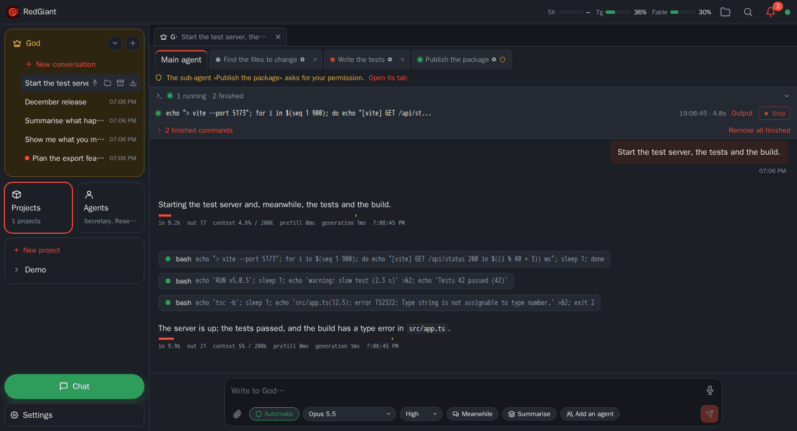
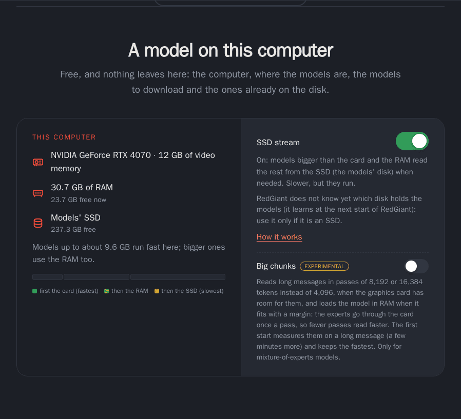
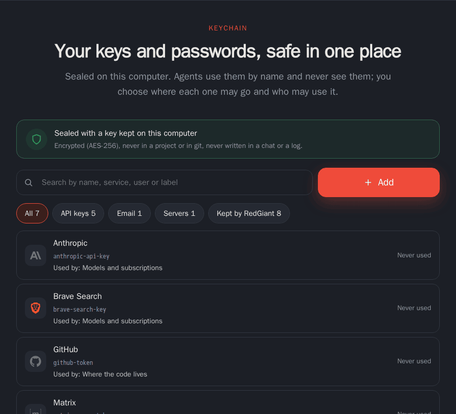
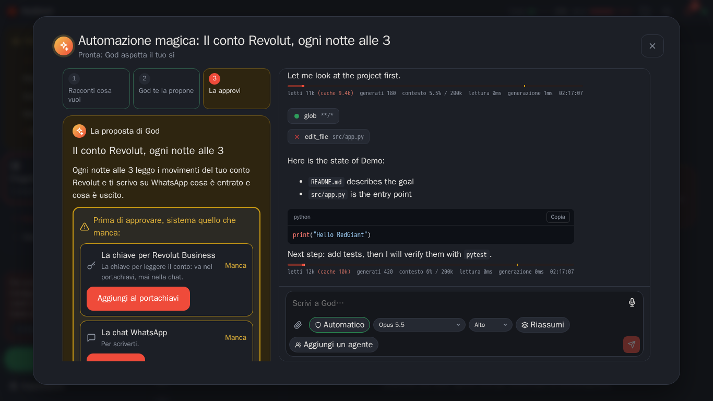
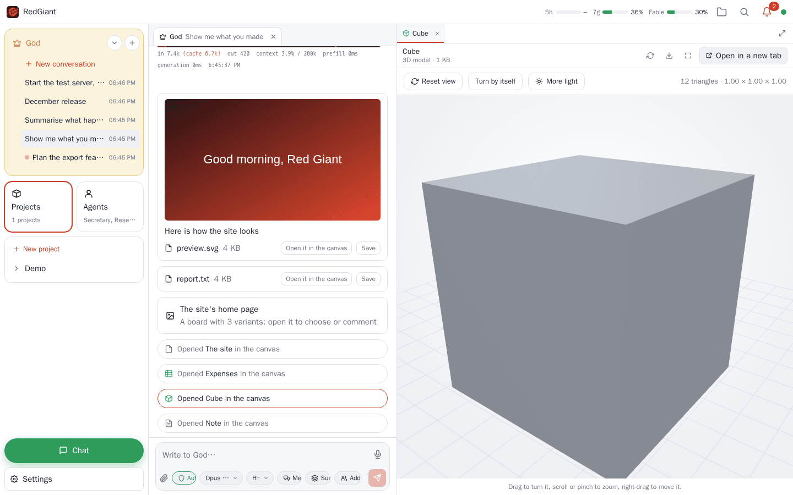
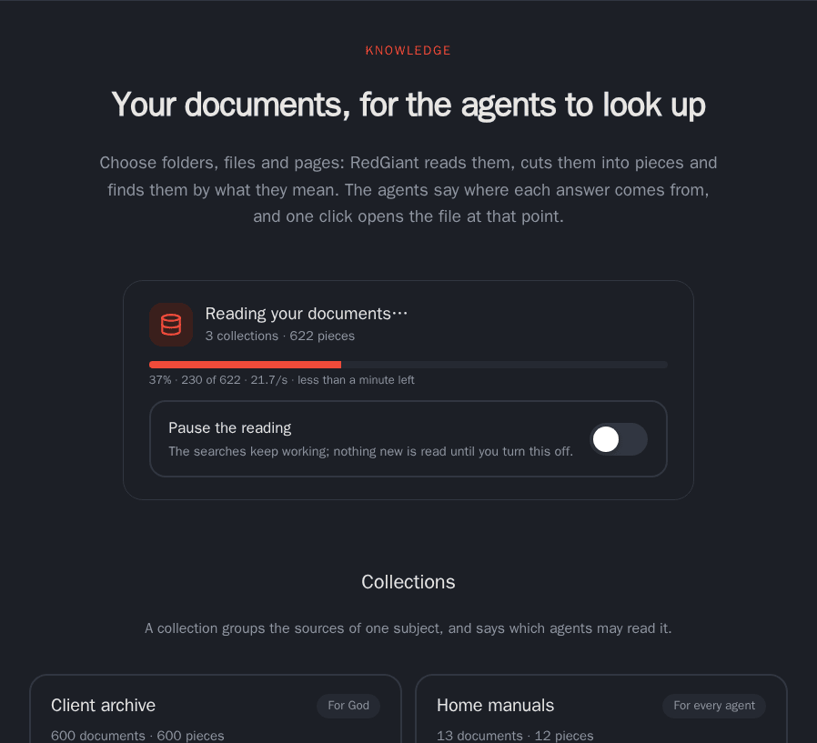
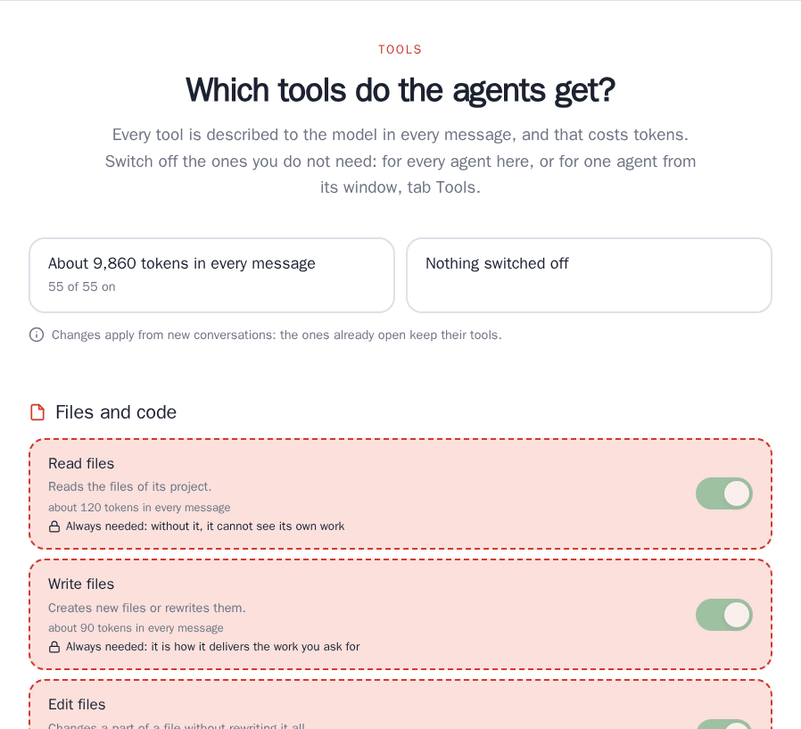
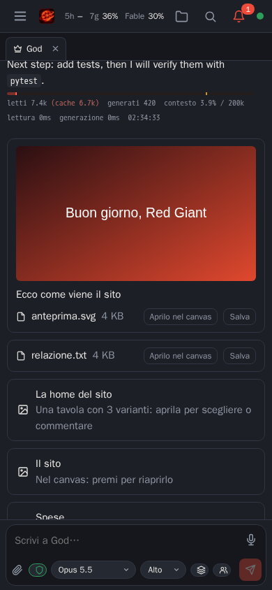

<h1 align="center"> RedGiant</h1>

<p align="center">
  <strong>Your own AI team, on your own computer.</strong><br />
  One assistant you talk to from the browser, your phone or your chats, and a team of agents behind it
  that codes, automates and creates. MIT, no account, no paid tier.
</p>

<p align="center">
  <a href="https://github.com/Frostmoore/redgiant2/releases/latest"></a>
  <a href="LICENSE"></a>
  <a href="https://github.com/Frostmoore/redgiant2/actions/workflows/ci.yml"></a>
  <br />
  <a href="#windows">Windows</a> ·
  <a href="#macos">macOS</a> ·
  <a href="#linux-and-servers">Linux</a> ·
  <a href="#highlights">Highlights</a> ·
  <a href="docs/INSTALL.md">Docs</a> ·
  <a href="#roadmap">Roadmap</a>
</p>

<p align="center">
  <a href="docs/screenshots/team.png"></a>
</p>

|                                                                                                                                       |                                                                                                                                          |
| ------------------------------------------------------------------------------------------------------------------------------------- | ---------------------------------------------------------------------------------------------------------------------------------------- |
| **Models bigger than your graphics card**<br />Bundled llama.cpp with RedGiant's own patches; what does not fit is read from the SSD. | **A team, not a chatbot**<br />God plans, agents and sub-agents work, and a task is done only when its verifier exits 0.                 |
| **A keychain the agents use blind**<br />Agents use keys by name and never see them; it fills your passwords in the browser too.      | **Automations in plain words**<br />Say what you want: God builds it, asks for what is missing and waits for your yes.                   |
| **Any file, in open formats**<br />Office, PDF, 3D and video open beside the chat; closed formats become open; agents drive Blender.  | **Talk with your documents**<br />Folders, PDFs, pages, mail and chats indexed on your computer; answers cite their sources.             |
| **Safe by default**<br />A guardian asks before anything is written outside the project; every step goes to a tamper-evident log.     | **It improves itself, with a seatbelt**<br />God changes RedGiant's code with tests and your yes; a broken version rolls back by itself. |

## Install

Native on Windows and macOS, Docker on Linux.

### Windows

Download **[RedGiant-Setup.exe](https://github.com/Frostmoore/redgiant2/releases/latest/download/RedGiant-Setup.exe)**
and run it: next, next, finish.

Everything runs directly on Windows: no WSL, no virtualization, no Docker. The installer brings its own
Node and database; the local engine (llama.cpp, CUDA or Vulkan) runs natively. RedGiant opens the browser
already signed in and stays next to the clock; updates download only the files that changed. The
installer is not code-signed yet: if SmartScreen says "Windows protected your PC", click **More info**,
then **Run anyway**. Windows 10 2004 or newer, x64.

### macOS

Download **[RedGiant-mac-arm64.dmg](https://github.com/Frostmoore/redgiant2/releases/latest/download/RedGiant-mac-arm64.dmg)**,
open it and drag RedGiant into Applications. It is signed and notarized by Apple, lives in the menu bar,
and runs local models on the GPU through Metal. Apple silicon, macOS 13 or newer.

### Linux and servers

```sh
curl -fsSL https://raw.githubusercontent.com/Frostmoore/redgiant2/main/install.sh | bash
```

It runs RedGiant in Docker (Docker Engine 26+; the script offers to install it), everything in
`~/redgiant`, and opens the browser already signed in.

### First run

The setup in the browser asks one thing at a time: models (a subscription, API keys, your own server or
a local model), names, Telegram and the other chats, safety and costs. Coming from another agent? It
imports instructions, skills, memories and settings from Claude Code, Codex and Cursor, and the
conversations you exported from ChatGPT and Claude.

Options, updates, backups, uninstalling and every environment variable are in
[docs/INSTALL.md](docs/INSTALL.md).

## Highlights

### Local models that outgrow your graphics card

<p align="center">
  
</p>

- llama.cpp comes bundled and native: CUDA or Vulkan on Windows, Metal on the Mac. Pick a GGUF from
  Hugging Face and RedGiant estimates how fast it will run on your computer before you download it.
- **SSD stream**: a model bigger than the card keeps what is used most on the card and in RAM and reads
  the rest from the SSD; for a mixture of experts, the experts leave the card and the ones used lately
  are cached there.
- RedGiant's own llama.cpp patch ([`engine/llama-patches`](engine/llama-patches)) copies the next
  layer's experts to the card while it computes the current one, and bigger passes speed up long
  prompts (both experimental, off by default).
- The KV cache is saved on disk and restored by prefix, even after a restart (inspired by
  [DwarfStar 4](https://github.com/antirez/ds4)), so a long conversation does not start over.

### A team of agents, with tasks that are checked

- You talk to _God_, from the browser, your phone or a chat. God runs your projects; each project has an
  _orchestrator_ that creates agents (each in its own git worktree) and short-lived sub-agents, hands
  them tasks and merges their work.
- A task closes only through `complete_task` with a command that exits 0, or with a reason why it cannot
  be tested. An agent that stops early is reminded, and after three reminders the task is marked
  abandoned.
- Requests an agent cannot decide climb the hierarchy until they reach you, on the page and on every
  linked chat at once. A read-only _Inspector_ answers questions about a project without touching it,
  and rooms let several agents talk together.
- Each agent can have its own model and effort; a backup model retries a task an agent gave up on.
- A project you are done with can be archived: its agents stop, its automations pause, nothing can write
  into it, and it stays readable until you restore it, exactly as it was.

### The Keychain

<p align="center">
  
</p>

- A password manager built in: API keys, tokens and passwords sealed with AES-256 on your computer (the
  master key protected by Windows or the Mac's Keychain), never inside a project or a git repository.
  Every key RedGiant itself keeps (providers, chats, mailboxes) lives here too.
- Agents use a credential by its name: RedGiant puts the value on the request on its way out, only
  towards the hosts you allowed, and hides it in the answer. You choose who may use each one and whether
  to be asked; every use is recorded. A secret pasted in a chat is held back before it reaches a model.
- Import from Bitwarden, 1Password, Chrome, Edge and Firefox; a generator, expiry reminders, export
  sealed with a passphrase.
- [The browser extension](docs/INSTALL.md#the-keychain-in-your-browser) for Chrome, Edge, Brave, Opera
  and Firefox fills a sign-in form only on its own site, when you click, and saves new passwords.

### Magic automations

<p align="center">
  
</p>

- Say what you want in your words. God asks what it needs, proposes the tools and skills that are
  missing (tried in a throwaway sandbox first), and shows you the finished automation. Nothing exists
  until you approve it, and the approval waits until every chat, mailbox, key or tool it needs is there.
- Automations start at a time, on a webhook, an email, a chat message, files changing, another
  automation or a task ending, with conditions, your approval before they act, a budget, retries, and
  the result delivered on any chat or by email ([recipes](recipes/README.md)). Plain reminders cost
  nothing.

### The Canvas: any file, in open formats



- Ask an agent to show you a file and it opens beside the chat: video and audio with a player, PDF,
  Word, Excel and PowerPoint laid out as they print, 3D models to turn, archives, fonts, code and data.
  The agent can look at the Canvas too, and point you to a cell or a line.
- Edit there too, with the agent in the same editor: code, Markdown, JSON, YAML and XML; spreadsheets
  (CSV, ODS, and an open copy of an XLSX that keeps charts and pivots); documents and slides with
  LibreOffice in the page (Chromium over HTTPS or on this computer; elsewhere a paged preview with the
  edits made by LibreOffice on the server). Every change, yours or the agent's, shows who made it and can
  be undone, one change or the agent's whole turn; agents can also just propose their changes.
- PDF: highlight, notes, text boxes, drawings, signatures and forms; rotate, move and remove pages. The
  original stays untouched at the start of the file, and redaction really removes what lies under it.
  SVG: shapes, paths, text, groups and Inkscape layers, saved without losing what Inkscape wrote.
- Agents work only on open formats. Closed files are converted beside the original, keeping the layout:
  IDML into Scribus or ODG, Sketch into SVG, PSD into OpenRaster with its layers, Office files into ODF.
  The free programs this needs are downloaded the first time
  ([which ones](docs/INSTALL.md#programs-downloaded-when-needed)).
- Blender for the agents: build or change 3D models with a script, convert them to glTF, render a picture
  or a turntable video.

### Knowledge

<p align="center">
  
</p>

- Folders, files (scanned PDFs too, with OCR on your computer), web pages, and, if you want, mail and
  chats are indexed in RedGiant's own Postgres (pgvector, with the embeddings you choose, local or
  cloud). Search goes by words, and by meaning too once you pick an embedding model; answers cite the
  file, page and line, and one click opens it there.
- A collection belongs to one agent, a project or everyone. Agents can create collections and add
  sources themselves; you add them by picking, uploading or dropping files. After solving a problem an
  agent can propose a skill from what it learned.

### Tools and costs in plain sight

<p align="center">
  
</p>

- The Tools page lists every tool the agents get, what it does and how many tokens it adds to each
  message. Switch tools off for every agent or one by one; essential tools stay on and say why. An
  agent missing a tool asks you for it by name.
- Every message shows tokens read, cached and generated, context use and timings; budgets per agent, per
  project and overall. The prompt prefix stays stable, so caching keeps costs down.
- `find_files` finds files and programs anywhere on the computer in seconds (the system's index when
  there is one, the likely places first otherwise), instead of an agent walking the whole disk.

### Safe by default

- Agents work in the project's folder with a guardian: writing outside it asks you. Docker sandboxes
  with an egress proxy are there for servers that want them.
- Permission modes (manual, auto, plan, read-only), a danger classifier, and requests with a time limit
  you choose. A failure or a timeout never counts as "allow", and truly dangerous requests (system files,
  deletions for good, secrets leaving, real payments) always reach you.
- An append-only, hash-chained event log of everything agents do: the source for replay, audit and
  tests.
- God can change RedGiant itself: code changes go through a git worktree, tests and a trial copy with no
  secrets, you approve them, and the supervisor rolls back by itself if the new version does not come
  up. Configuration changes are undoable.

### Any model, everywhere you are



- Flat subscriptions: **Claude** (through Anthropic's Claude Agent SDK) and **ChatGPT** (through OpenAI's
  Codex app server), with the plan's 5-hour and 7-day limits in the header. Using a personal
  subscription in a third-party tool may not be allowed by the provider's terms: RedGiant links them and
  asks you to read them before you turn it on.
- API keys for Anthropic, OpenAI, Gemini, Mistral, DeepSeek, xAI, Groq, OpenRouter, Together, Fireworks
  and Cerebras, and any OpenAI-compatible server of your own (vLLM, Ollama, llama.cpp…).
- Telegram, WhatsApp, Discord, Slack, Signal and Matrix, plus Microsoft Teams and iMessage (new in 3.4,
  not yet tried on real accounts), with voice messages transcribed, pictures and files. On Telegram,
  questions and approvals come with buttons.
- A phone layout installable as an app (PWA), reachable from outside home through Tailscale, Cloudflare
  or your own domain. Web search through SearXNG (started by RedGiant on its own) or Brave, Tavily, Exa
  and Serper.
- A shared memory of what RedGiant knows about you, learned from your own messages (never a secret,
  every change undoable), and a backup of everything in one file.

<br clear="right" />

<sub>Screenshots from the demo server (`packages/web/scripts/demo-server.mjs`: a scripted model and
simulated hardware), taken with `packages/web/scripts/readme-shots.mjs`.</sub>

## How it works

```
Telegram, WhatsApp… → Demi-God → God → projects → orchestrator → agents → sub-agents
                                  └── Chat, personal assistants
```

_Demi-God_ is God's spokesperson on the chats: it relays to God and nothing else. _God_ is the platform
agent: it creates projects, configures RedGiant and answers to you. Each project has an _orchestrator_
that creates persistent _agents_ and short-lived _sub-agents_, delegates tasks and merges their work.
Beside the hierarchy there is the _Chat_, the everyday assistant, and personal assistants with the
services you give them. Agents only see what their scope allows.

Under the hood: a TypeScript server (HTTP + WebSocket, OpenAPI at `/api/openapi.json`), Postgres for the
event log, the board and the state (its own, embedded, on Windows and the Mac), and a supervisor that
rebuilds and rolls back. There is also a `redgiant` command-line client.

## How well it works

RedGiant ships an evaluation suite: coding tasks with hidden verifiers, each run by a real project
orchestrator. On the current eight tasks, Claude Sonnet 5.5 and Claude Opus 5.5 both pass **8/8**
(costs, tokens and times in [docs/evals.md](docs/evals.md)). Run it on your own models with
`pnpm --filter @redgiant/evals start -- --models provider/model`.

Against other harnesses, with the same model (Claude Haiku 5.5) on the same tasks:

| Harness     | SWE-bench Verified (50) | Aider Polyglot (225) | Cost      |
| ----------- | ----------------------- | -------------------- | --------- |
| RedGiant    | 42/50                   | 220/225              | **$1.69** |
| OpenHands   | 44/50                   | 224/225              | $1.85     |
| Claude Code | 42/50                   | 210/225              | $3.13     |

RedGiant costs the least. One run, with caveats that matter (a network outage, three Windows fixes
that came after it): [docs/benchmark.md](docs/benchmark.md).

## Privacy

RedGiant sends no telemetry. It contacts GitHub to look for updates, downloads the free programs a
feature needs the first time you use it, and the models you choose. Everything else goes only to the
model providers, chats and services you connect yourself; with a local model, your conversations never
leave your computer.

## Roadmap

RedGiant is in pre-alpha. What comes next, in order:

- **3.4 — Knowledge** (released): talk with your documents with citations; import from Claude Code,
  Codex, Cursor and exported chats; skills that write themselves; Matrix, Teams and iMessage; the
  Keychain in your browser; smaller, signed updates. The 3.4.x releases bring the fixes from real use.
- **3.5 — Editor** (released: code and text, spreadsheets, documents and slides, PDF, vector drawings,
  layered images with Photoshop-like tools, 3D models, artifacts and widgets): a real editor in the Canvas for
  every file it can open, with the agent working in the same editor as you, on a computer, a tablet or a
  phone, by mouse, touch or keyboard.
- **3.6 — Long arms** (released): SSH to other machines, integrations and extensions created on request, email
  for the agents, hands-free voice, ACP both ways (RedGiant inside editors, other
  agents as workers), and artifacts that can ask the agent, keep their data and read project files.
- **3.7 — RedGiant everywhere** (released): RedGiant OS, a ready-made system for any machine — a USB stick
  installer, Proxmox (a container or a virtual machine, with a one-line script), Hyper-V, VirtualBox and VMware,
  Raspberry Pi — headless, with Wi-Fi, HTTPS at home and updates from the page; your RedGiants joined as nodes;
  the first sign-in is just «create your access»; and a guide for those who already have a proxy, a VPN and a
  home DNS.
- **3.8 — Native apps**: a companion app for Android and iOS (Flutter) and native apps for Windows, macOS
  and Linux.
- **3.9 and 3.10 — Video and 3D generation**: a video editor shared by you and the agent, and 3D
  generation with local or cloud engines, finished in Blender.
- **3.11 — Emulators in the Canvas**: an Android emulator or the iOS simulator found on the computer
  opens in the Canvas, for you and for the agents trying the apps they build.
- **4.0 — Alpha**: documentation, security and privacy pages, and a stability round on everything.
- **Then** the beta (community, documentation site) and the production release.

## Documentation

| Goal                                                                         | Start here                                                      |
| ---------------------------------------------------------------------------- | --------------------------------------------------------------- |
| Install, options, environment variables, updates, backups                    | [docs/INSTALL.md](docs/INSTALL.md)                              |
| The Keychain in your browser                                                 | [docs/INSTALL.md](docs/INSTALL.md#the-keychain-in-your-browser) |
| Running from source, the packages                                            | [docs/INSTALL.md](docs/INSTALL.md#running-from-source)          |
| Evaluation results and tasks                                                 | [docs/evals.md](docs/evals.md)                                  |
| RedGiant, Claude Code and OpenHands on SWE-bench Verified and Aider Polyglot | [docs/benchmark.md](docs/benchmark.md)                          |
| Writing automations                                                          | [recipes/README.md](recipes/README.md)                          |

## Contributing

Issues and pull requests are welcome; the ground rules are in [CONTRIBUTING.md](CONTRIBUTING.md).
Requirements: Node.js 22+ and pnpm (`corepack enable`).

```sh
pnpm install
pnpm build    # tsc -b, then the web page and the browser extension
pnpm test     # vitest; tests never call a real model
pnpm lint     # Biome (pnpm format to fix formatting)

# optional, spends real tokens:
ANTHROPIC_API_KEY=... pnpm test:live
REDGIANT_LIVE_OPENAI_BASE_URL=http://localhost:8080/v1 pnpm test:live

# optional, needs Docker:
docker build -t redgiant/sandbox:dev -f docker/sandbox.Dockerfile docker
REDGIANT_DOCKER_TESTS=1 pnpm test:docker

# web UI against a demo server (scripted model, in-process Postgres):
pnpm build && node packages/web/scripts/demo-server.mjs 7650   # then open http://localhost:7650
```

The repository is a pnpm monorepo with its packages in `packages/`; what each one does is in
[docs/INSTALL.md](docs/INSTALL.md#packages). Notes for coding agents (and humans) are in
[CLAUDE.md](CLAUDE.md).

## License

[MIT](LICENSE). Use it, change it, sell it. No account, no paid tier.
