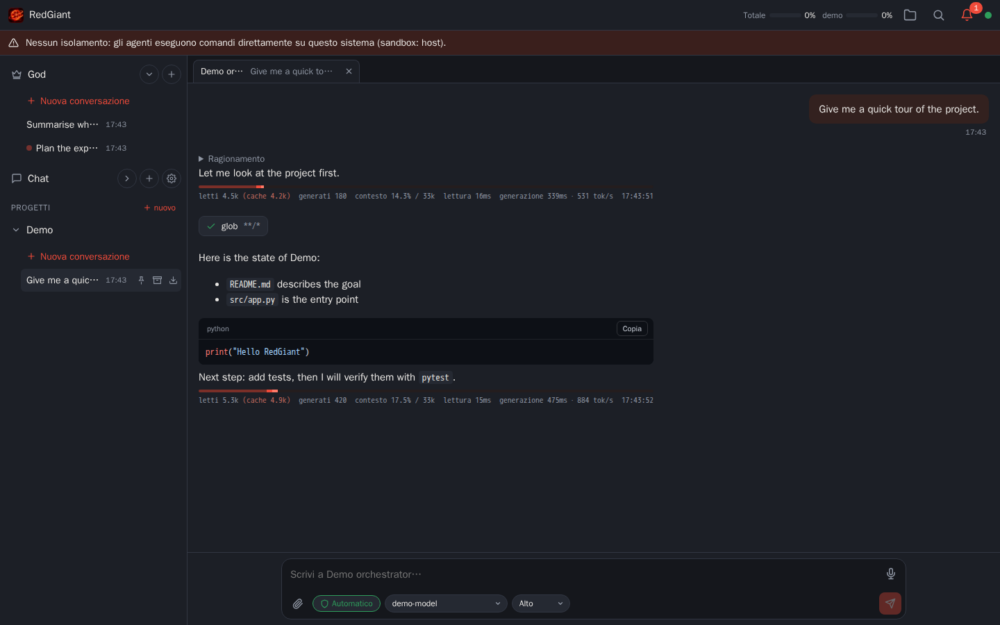
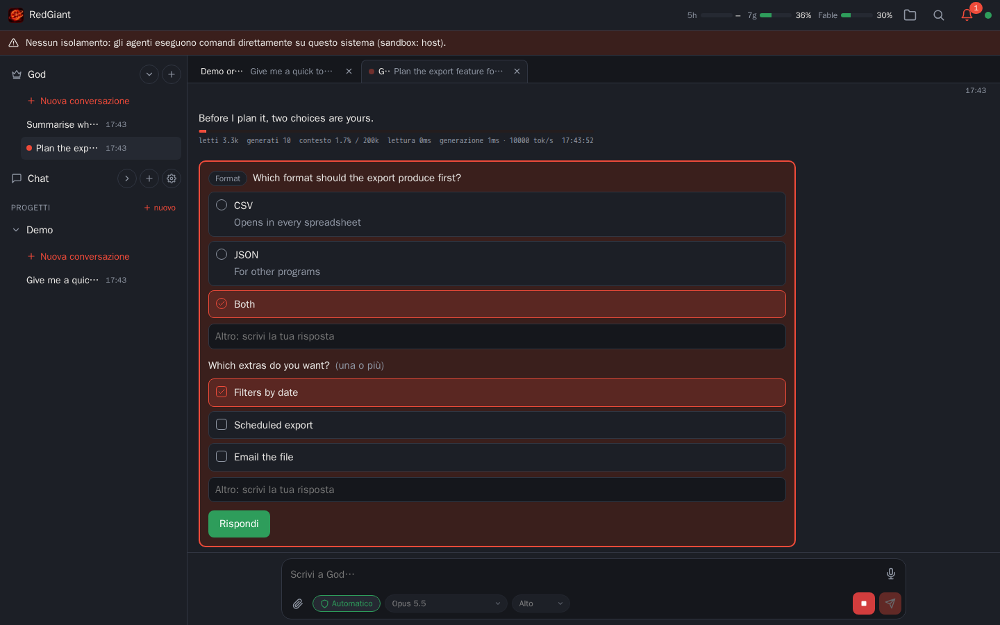
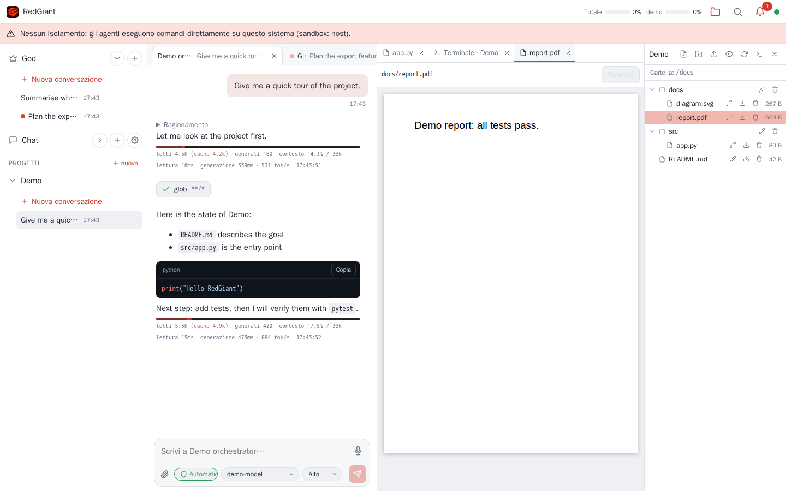

<p align="center">
  
</p>

<h1 align="center">RedGiant 2</h1>

<p align="center">
  <strong>A self-hosted, open-source harness for a team of AI agents.</strong><br />
  Built first for coding, and just as useful as a daily assistant or an automation runner.<br />
  It runs on your own machine or server, in Docker, with cloud models, your subscription or local ones.
</p>

<p align="center">
  <a href="#install">Install</a> ·
  <a href="#features">Features</a> ·
  <a href="#how-it-works">How it works</a> ·
  <a href="docs/INSTALL.md">Docs</a> ·
  <a href="docs/evals.md">Evals</a>
</p>



## Why RedGiant

You talk to one agent, _God_, from the browser or from Telegram. God runs your projects; each project
has an orchestrator that hands work to its own agents and sub-agents. Every command they run happens
in a Docker sandbox. Every task is checked by a verifier before it counts as done, and everything they
do is written to a tamper-evident log. You keep the keys, the data and the final say.

## Features

**A workbench in the browser**

- Laid out like a coding workbench: conversations and settings on the left, tabs in the middle, the
  project's files, an editor (CodeMirror), previews (images, PDF) and terminals on the right.
- Every message shows tokens read, cached and generated, context usage and timings; budgets per agent,
  per project and overall.
- Light and dark themes (or the system's), Italian and English, a phone layout. Installable on the phone
  as an app (PWA); pair a device by scanning a QR code.
- Questions from agents arrive as cards you answer with a click; push notifications through
  [ntfy](https://ntfy.sh) for approvals, questions, long or failed turns and budgets.

**Any model**

- The Anthropic API and any OpenAI-compatible server (vLLM, Ollama, OpenRouter, llama.cpp…).
- A bundled local engine (llama.cpp): pick a GGUF model from Hugging Face in the setup wizard. Its KV
  cache is saved on disk and restored by prefix, even across restarts (inspired by
  [DwarfStar 4](https://github.com/antirez/ds4)).
- Flat subscriptions: **Claude** (through Anthropic's Claude Agent SDK) and **ChatGPT** (through OpenAI's
  Codex app server), with the plan's 5-hour and 7-day limits shown in the header. Using a personal
  subscription in a third-party tool may not be allowed by the provider's terms: RedGiant links them and
  asks you to read them before you turn it on.
- Each agent can have its own model and effort.

**Safe by default**

- Each workspace gets its own Docker sandbox; the only way out is an egress proxy with an allow list.
  Secrets never enter the sandbox: credentials are added by the proxy on the way out.
- Permission modes (manual, auto, plan, read-only), a danger classifier, and approvals that climb the
  hierarchy up to you, in the web UI or with Telegram buttons. A failure or a timeout never counts as
  "allow".
- An append-only, hash-chained event log of everything agents do: the source for replay, audit and tests.

**Work that gets done, and checked**

- Tasks close only when a verifier passes (or the agent records why the result cannot be tested).
- A board where agents post tasks, results, questions and decisions; you can read and search it too.
- Automations: cron schedules, one-shot runs, webhooks, and plain reminders that cost nothing
  ([recipes](recipes/README.md)).
- Extensions: skills, custom tools that run in the sandbox, and MCP servers. Agents can propose new
  ones; they are tested in a throwaway sandbox and wait for your approval.
- Images in and out (`generate_image`), voice messages transcribed with Whisper, web search (SearXNG).
- God can change RedGiant itself: changes go through a git worktree, tests and a trial copy, you approve
  them, and a supervisor rolls back by itself if the new version does not come up.

<table>
  <tr>
    <td width="66%"></td>
    <td rowspan="2"></td>
  </tr>
  <tr>
    <td></td>
  </tr>
</table>

<sub>Screenshots from the demo server (`packages/web/scripts/demo-server.mjs`), with the UI in Italian.</sub>

## Install

### Windows

1. Download **`RedGiant-Setup.exe`** from the
   [latest release](https://github.com/Frostmoore/redgiant2/releases/latest).
2. Double-click it: next, next, finish.

The installer switches on WSL (the Linux built into Windows) if it is not on yet. That is the only step
that asks for administrator rights; if Windows needs a restart, setup continues by itself afterwards.
Docker runs inside RedGiant's own WSL distribution, so **Docker Desktop is not needed**. You get a
RedGiant icon on the desktop and in the Start menu (and, if you like, RedGiant starting with Windows);
it opens the browser already signed in and stays next to the clock.

The installer is not code-signed yet, so SmartScreen may say "Windows protected your PC": click
**More info**, then **Run anyway**. Windows 10 2004 or newer, x64.

### Linux and macOS

```sh
curl -fsSL https://raw.githubusercontent.com/Frostmoore/redgiant2/main/install.sh | bash
```

It needs Docker Engine 26+ (on Linux the script offers to install it; on macOS use Docker Desktop or
OrbStack). Everything goes in `~/redgiant`, and the browser opens already signed in.

### First run

The setup wizard in the browser asks for the rest: models (API keys, a subscription, or a local model
from Hugging Face), names and prompts, Telegram, safety and costs.

Options, updates, backups, uninstalling and every environment variable are in
[docs/INSTALL.md](docs/INSTALL.md).

## How it works

```
Telegram → Demi-God → God → projects → orchestrator → agents → sub-agents
```

_Demi-God_ is God's spokesperson on Telegram: it relays to God and nothing else. _God_ is the platform
agent: it creates projects, configures RedGiant and answers to you. Each project has an _orchestrator_
that creates persistent _agents_ (each in its own git worktree) and short-lived _sub-agents_, delegates
tasks to them and merges their work. Each project also has a read-only _Inspector_ you can ask about it
without touching anything, and next to the hierarchy there is a plain _daily chat_ with web search for
everyday questions. Agents only see what their scope allows, and requests they cannot decide go up the
tree until they reach you.

Under the hood: a TypeScript server (HTTP + WebSocket, OpenAPI at `/api/openapi.json`), Postgres for the
event log, the board and the state, one sandbox container per workspace, and a supervisor that rebuilds
and rolls back. There is also a `redgiant` command-line client.

## How well it works

RedGiant ships an evaluation suite: coding tasks with hidden verifiers, each run by a real project
orchestrator. On the current eight tasks, Claude Sonnet 5.5 and Claude Opus 5.5 both pass **8/8**
(costs, tokens and times in [docs/evals.md](docs/evals.md)). Run it on your own models with
`pnpm --filter @redgiant/evals start -- --models provider/model`.

## Documentation

- [docs/INSTALL.md](docs/INSTALL.md): installing, options, environment variables, updates, backups,
  running from source, the packages
- [docs/evals.md](docs/evals.md): evaluation results and tasks
- [recipes/README.md](recipes/README.md): writing automations

## Contributing

Issues and pull requests are welcome. Requirements: Node.js 22+ and pnpm (`corepack enable`).

```sh
pnpm install
pnpm build    # tsc -b
pnpm test     # vitest; tests never call a real model
pnpm lint     # Biome (pnpm format to fix formatting)

# optional, spends real tokens:
ANTHROPIC_API_KEY=... pnpm test:live
REDGIANT_LIVE_OPENAI_BASE_URL=http://localhost:8080/v1 pnpm test:live

# optional, needs Docker:
docker build -t redgiant/sandbox:dev -f docker/sandbox.Dockerfile docker
REDGIANT_DOCKER_TESTS=1 pnpm test:docker

# web UI against a demo server (scripted model, in-process Postgres):
pnpm build && node packages/web/scripts/demo-server.mjs 7650   # then open http://localhost:7650
```

The repository is a pnpm monorepo with its packages in `packages/`; what each one does is in
[docs/INSTALL.md](docs/INSTALL.md#packages). Notes for coding agents (and humans) are in
[CLAUDE.md](CLAUDE.md).

## License

[MIT](LICENSE). Use it, change it, sell it.
